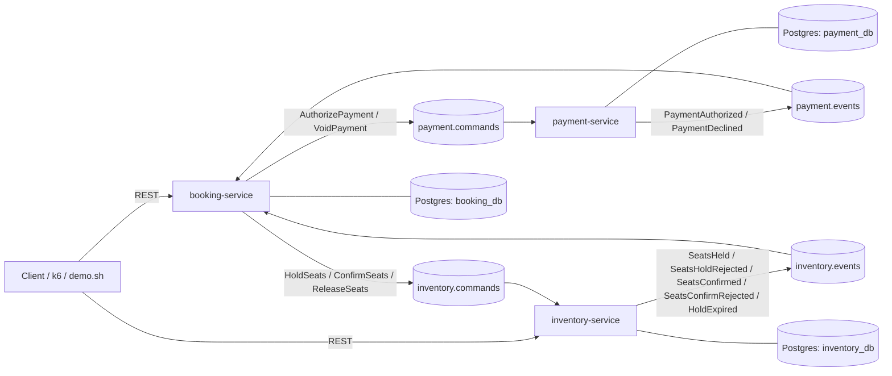
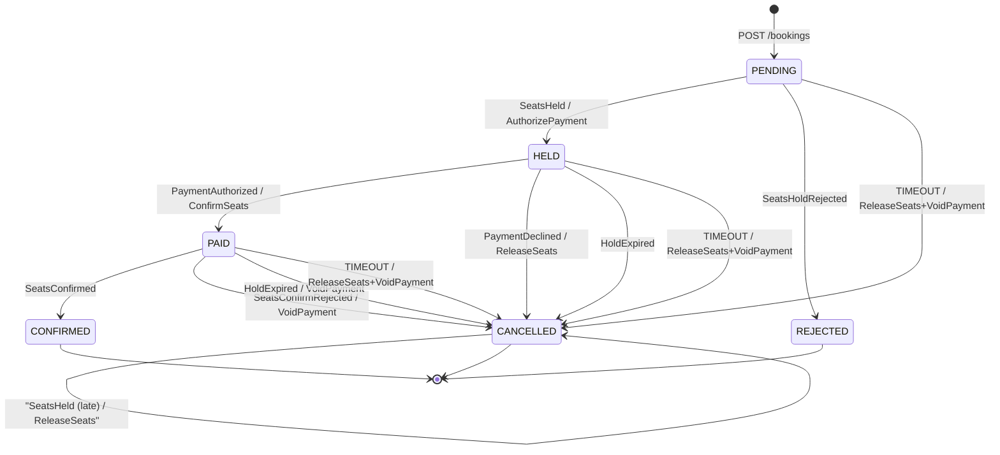

# Seat Booking Saga

A seat-reservation system built around a choreographed saga across three independent Spring Boot services, coordinated entirely through Kafka — no distributed transaction, no service calling another synchronously. Built to prove, not just implement: every correctness property below has a Testcontainers test, a live manual run, or a load/chaos test behind it.

## Architecture



Each service owns its database exclusively — no shared schema, no cross-service joins. Every outbound message goes through a transactional outbox (written in the same transaction as the business change it announces, relayed to Kafka on a poll loop) and every inbound message through an inbox table keyed by message id, so delivery is at-least-once end to end but every effect applies exactly once.

## The saga



`BookingStateMachine` is pure, dependency-free logic — every row above is one table-driven test case, and every `(state, event)` pair *not* listed above is exhaustively tested as a no-op, which is what makes duplicate and out-of-order delivery safe by construction rather than by convention.

## Running it

```
mvnw -B -ntp install -DskipTests
mvnw -pl booking-service package spring-boot:build-image -DskipTests
mvnw -pl inventory-service package spring-boot:build-image -DskipTests
mvnw -pl payment-service package spring-boot:build-image -DskipTests
docker compose up -d
bash scripts/demo.sh
```

`demo.sh` seeds a show and runs all six core scenarios — happy path, duplicate request, seat conflict, payment declined, hold expiry, and late payment — end to end against the live stack, printing pass/fail for each.

## Key design decisions

**Transactional outbox over publish-then-commit.** Publishing to Kafka and committing the business change can't be one atomic operation across two different systems. Writing the outbound message to a table in the *same* database transaction as the change it announces, then relaying it to Kafka on a separate poll loop, means the message can never be lost even if the process crashes between commit and publish — at the cost of at-least-once delivery, which the inbox table on the receiving side turns back into exactly-once effects.

**Seats locked individually, in a fixed sorted order — never via a single `SELECT ... FOR UPDATE ORDER BY`.** Postgres guarantees `ORDER BY` governs the order rows are *returned*, not the order they're *locked* while the planner scans them. A multi-seat hold locks each requested seat with its own statement, in alphabetical order, so every concurrent request touching any of the same seats acquires locks in the same relative sequence — which is what actually rules out a deadlock, not the query's own ordering clause.

**`PROPAGATION_NESTED`, not the default `REQUIRED`, for every domain service composed inside `IdempotentConsumer`'s transaction.** A service like `SeatHoldService` can reject a request after writing a partial result, and needs to roll back just that partial write. Under the default propagation, a nested `setRollbackOnly()` marks the *entire shared* transaction doomed — including the inbox-row write and outbox-event publish the caller does right after — producing `UnexpectedRollbackException` for what's really just an ordinary business outcome, not a failure. `NESTED` uses a real savepoint instead, scoped to just that method's own writes.

**Every message is keyed by the booking's own id, not left to a random partition.** Kafka's default partitioner hashes the key, so every command and event belonging to the same booking always lands on the same partition and is processed by the same thread, in order — regardless of how many partitions or consumer threads exist. This is what let `inventory-service`'s listener concurrency go from 1 to 3 (Step 8) with zero risk to per-booking ordering, without that safety being the reason the key scheme was chosen in the first place.

**The saga-timeout reaper is a deliberate last resort, not the primary recovery path.** `HoldExpired` and `PaymentDeclined` are the normal ways a stuck-looking booking gets resolved. The reaper's own timeout is set well past how long any legitimate attempt — including an artificially slow payment — should ever take, so in ordinary operation it never fires at all. It exists specifically for a message that's genuinely lost: a publish that silently failed, or one that landed on a dead-letter topic instead of being redelivered.

## Load testing (k6)

**Scenario 1 — 500 seats, 5,000 single-seat requests, 10 competing attempts per seat, all payments succeeding.**

| Metric | Single-threaded consumer | Listener concurrency = 3 |
|---|---|---|
| Final split | 500 CONFIRMED / 4,500 REJECTED | 500 CONFIRMED / 4,500 REJECTED |
| Wall clock to full resolution | 323.5s | 294.5s |
| Completions/sec | 15.46 | 16.98 |
| REJECTED avg / max | 166.7s / 286.2s | 164.0s / 228.4s |
| CONFIRMED avg / max | 274.2s / 320.2s | 248.5s / 288.4s |
| Consistency check after | clean | clean |

Tripling listener concurrency to match the topic's partition count improved the tail (max times down 10–20%) but barely moved the average, and completions/sec rose only ~10%, not the ~3x a naive read of "3x the threads" would predict. The likely reason: Postgres's own per-seat row lock already serializes the ten competing requests for any *one* seat, regardless of which Kafka partition or thread they arrive on. More consumer threads let *different* seats proceed in parallel; they don't touch the lock contention on any single hot seat. At this scale, Postgres row-level locking is the tighter real ceiling, not Kafka consumer parallelism.

**Scenario 2 — 200 seats, 788 requests across overlapping party sizes 1–4, all 197 valid starting positions.** 103 CONFIRMED / 685 REJECTED, zero double-booking — checked three independent ways: the consistency checker, a direct SQL query for any seat claimed by more than one confirmed booking, and the final-state counts. All three agree.

## Chaos testing

Both scenarios run scenario 1's full load while deliberately breaking something mid-run, confirming the asynchronous design holds: `POST /bookings` never calls Kafka or another service synchronously, so the API itself should see zero failures even during an outage — only the backlog behind it grows and later drains.

| Scenario | HTTP failures | Final split | Consistency check |
|---|---|---|---|
| `kill -9` on inventory-service, ~24s into the run, restarted after ~10s | 0 / 5,000 | 500 / 4,500 | clean |
| Kafka broker paused (`docker compose pause`) for ~10s mid-run | 0 / 5,000 | 500 / 4,500 | clean |

The inventory-service kill produced a visible latency spike (p95 response time briefly over 900ms, one outlier past 45s) — consistent with a fresh JVM restart competing for the same shared Postgres instance and host resources while rejoining its Kafka consumer group, not a break in the design itself.

## What would break at 10×

- **Postgres row-level locking on the hottest seats becomes the dominant ceiling**, not Kafka throughput — demonstrated directly in the concurrency experiment above. At 10× today's load, a handful of extremely popular seats (a front row, a VIP booth) would concentrate far more contention per row than this test's evenly-distributed ten-attempts-per-seat pattern ever created.
- **Booking-id partition keying, while necessary for correctness, creates a hot-partition risk.** One pathologically popular event concentrates all of *its* traffic onto whichever partitions its bookings happen to hash to — adding more partitions doesn't rebalance load already concentrated behind a small number of keys.
- **One Postgres instance hosting all three logical databases is a single point of contention**, let alone failure — at 10×, the three services' combined connection and I/O load would compete for the same underlying resource. Separate instances per service, or at least per-service read replicas for the consistency checker's own queries, would be the first real infrastructure change.

## Project structure

```
common/             Shared: message envelope, outbox, inbox, Kafka listener config, consistency checker
booking-service/    Saga orchestration: state machine, HTTP API, saga-timeout reaper
inventory-service/  Seat holds, confirms, releases, expiry sweeper
payment-service/    Deterministic mock gateway (decline-/slow- id prefixes)
scripts/demo.sh     Automated run of all six core scenarios against the live stack
scripts/load/       k6 load scenarios (Step 8) and the shared wait-for-bookings.sh helper
```

## Tech stack

Java 21, Spring Boot 4.1, PostgreSQL 16, Apache Kafka 4.0 (KRaft mode), Flyway, Testcontainers, k6, Docker Compose, Cloud Native Buildpacks (`spring-boot:build-image`, no hand-written Dockerfiles).